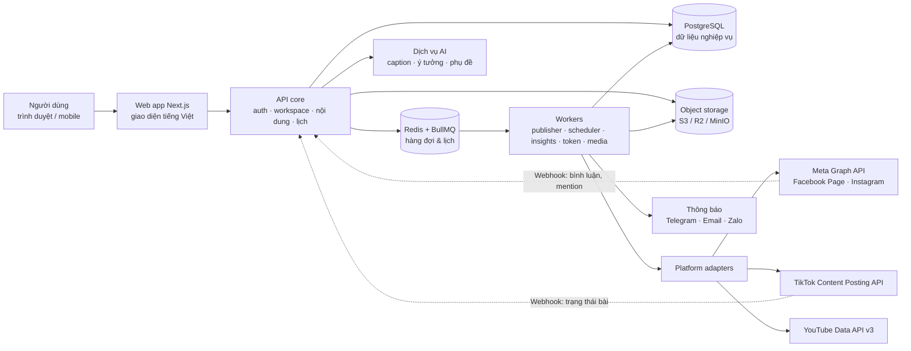
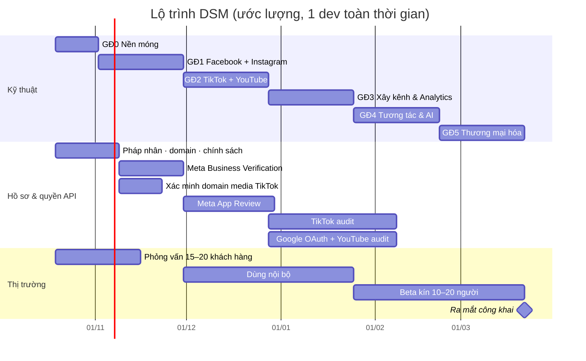
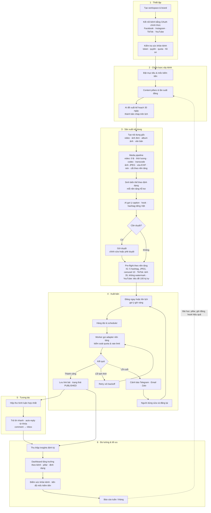
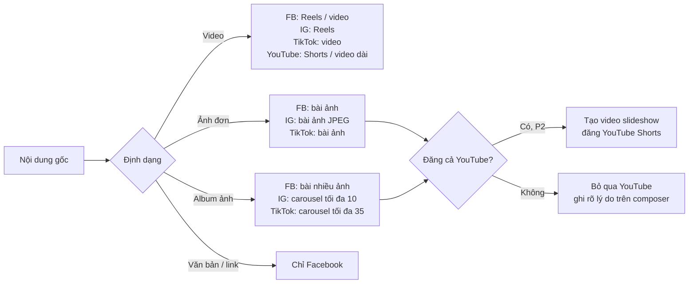
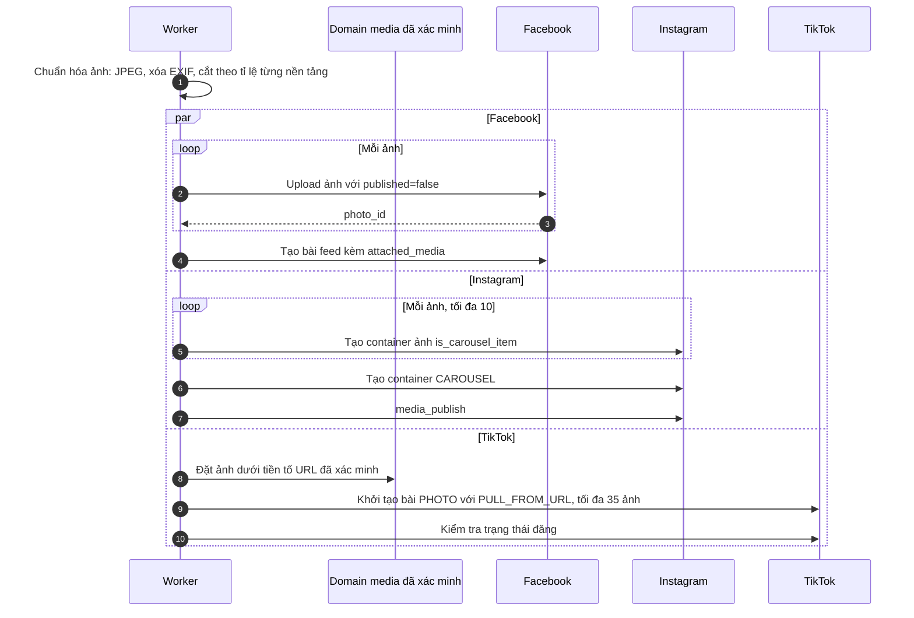
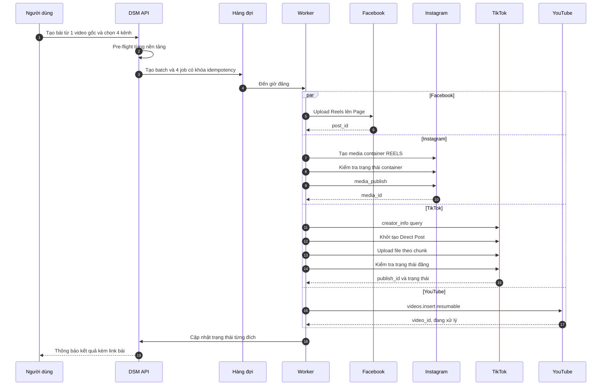
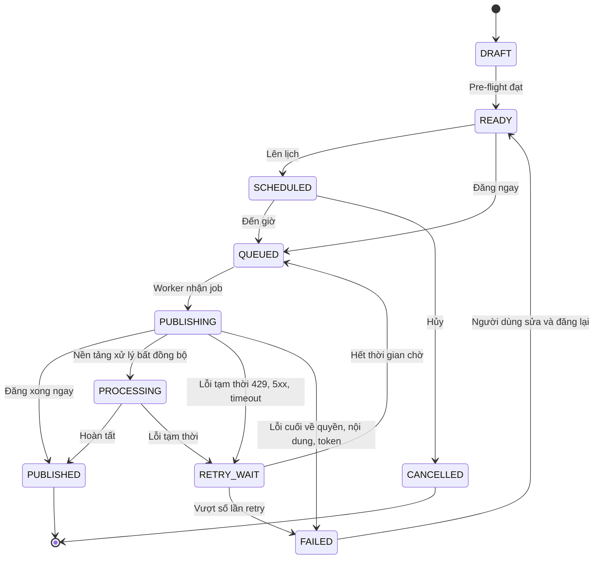

# DSM — Kế hoạch phát triển: nền tảng quản lý & xây kênh mạng xã hội

Ngày: 2026-10-13
Trạng thái: Đã duyệt làm khung (13/10/2026); chi tiết chốt trong spec riêng của từng sub-project (mục 13)
Thay thế: mục 6, 7 và 9 của bản "DSM V1 — Tổng kết tiến độ & định hướng phát triển" (13/10/2026)
Cập nhật 13/10/2026: bổ sung đăng ảnh (ảnh đơn, album/carousel) bên cạnh video — xem mục 3.1

> Tài liệu này định hướng lại DSM từ "Dropship Social Manager" thành **web quản lý và xây kênh mạng xã hội cho thị trường Việt Nam**, ưu tiên Facebook → Instagram → TikTok → YouTube. Số liệu thị trường và giới hạn API được tra cứu ngày 13/10/2026; những con số đến từ nguồn thứ cấp được ghi rõ là cần kiểm chứng.

---

## 0. Tóm tắt

- **Định vị:** trợ lý xây kênh đa nền tảng cho người Việt. Một nội dung gốc (video, ảnh đơn hoặc album ảnh) → Facebook, Instagram, TikTok, YouTube theo đúng định dạng mỗi nền tảng hỗ trợ; biết kênh nào đang lớn, còn bao xa tới mốc kiếm tiền; chỉ dùng API chính thức.
- **Khách hàng đầu tiên:** creator/KOC và người xây nhiều kênh (4–12 kênh). Sau đó mở rộng sang freelancer/agency nhỏ.
- **Thứ tự xây dựng:** Facebook + Instagram (cùng một hệ Meta API) → TikTok + YouTube.
- **Đường găng không nằm ở code mà ở hồ sơ duyệt API** (Meta App Review + Business Verification, TikTok audit, Google OAuth verification + YouTube audit). Hồ sơ phải chạy song song từ tuần đầu.
- **Lộ trình:** 6 giai đoạn, khoảng 5 tháng cho 1 dev toàn thời gian (ước lượng, chưa phải cam kết).
- **Threads và Browser Gateway/GPMLogin:** giữ nguyên như hiện tại (quyết định 13/10/2026). Không thuộc 4 nền tảng ưu tiên nên không đầu tư thêm; rủi ro điều khoản của Browser Gateway được theo dõi ở mục 10.
- **Nền móng kỹ thuật phải sửa trước:** CI chưa từng chạy, runtime đang là bộ nhớ trong + snapshot JSON (xem bản đánh giá 13/10).

---

## 1. Giả định

1. DSM là sản phẩm SaaS cho thị trường Việt Nam. Giai đoạn đầu dùng nội bộ (dogfood) trên kênh của chủ dự án, sau đó beta kín, rồi mở công khai.
2. Nhân sự: 1 dev toàn thời gian, có trợ lý AI. Ước lượng thời gian dựa trên giả định này.
3. Chỉ dùng API chính thức của nền tảng. Không buff tương tác, không quản lý nick ảo, không đăng qua trình duyệt antidetect.
4. Giữ các nguyên tắc đã có: không KPI giả, không trạng thái giả, từ chối khi thiếu điều kiện, mọi trạng thái PASS phải có bằng chứng CI gắn với commit SHA.

---

## 2. Phân tích thị trường

### 2.1. Quy mô và hành vi

| Chỉ số | Giá trị | Ghi chú |
|---|---|---|
| Danh tính mạng xã hội đang hoạt động | 79,0 triệu (10/2025) | DataReportal Digital 2026 Vietnam |
| Facebook | khoảng 76–79 triệu | Nguồn thứ cấp trích dữ liệu quảng cáo Meta cuối 2025, cần kiểm chứng |
| TikTok | khoảng 76 triệu người 18+ | Nguồn thứ cấp; số liệu quảng cáo TikTok từng điều chỉnh mạnh giữa 2024–2025 |
| YouTube | khoảng 62 triệu, phủ khoảng 72,5% người dùng internet | Dữ liệu quảng cáo Google cuối 2025, qua nguồn thứ cấp |
| Instagram | không có số đáng tin cho 2026 | Nhỏ hơn rõ rệt so với ba nền tảng còn lại |
| Zalo | khoảng 78 triệu | Nguồn thứ cấp, chưa kiểm chứng |
| GMV 4 sàn TMĐT 2025 | khoảng 16,3 tỷ USD (+34,8%) | Metric.vn qua e27 |
| Thị phần GMV 2025 | Shopee khoảng 56%, TikTok Shop khoảng 41,3% | TikTok Shop vượt Shopee về doanh số dịp Tết 2026 (khoảng 52%) |

**Đọc số liệu:** người dùng Việt dùng cùng lúc nhiều nền tảng, và video ngắn dọc (Reels, TikTok, Shorts) là định dạng chung của cả bốn nền tảng DSM ưu tiên. Ảnh và album ảnh vẫn là định dạng hằng ngày của Facebook, Instagram và TikTok (Photo Mode), nhất là với shop và nội dung sản phẩm. Đây là nền tảng cho tính năng cốt lõi "một nội dung → bốn nền tảng". Instagram nhỏ ở Việt Nam nhưng dùng chung hạ tầng Meta với Facebook, nên chi phí thêm Instagram sau Facebook rất thấp. Vì vậy thứ tự FB → IG hợp lý về kỹ thuật dù IG không phải nền tảng lớn nhất.

### 2.2. Xu hướng ảnh hưởng tới sản phẩm

1. **Video ngắn và thương mại xã hội tăng mạnh.** TikTok Shop tăng thị phần nhanh nhờ livestream và video bán hàng; creator/KOC trở thành kênh phân phối chính.
2. **Công cụ gốc miễn phí tốt lên.** Meta Business Suite, YouTube Studio, TikTok Studio đều lên lịch miễn phí. DSM không thể chỉ bán "lên lịch đăng bài"; giá trị phải nằm ở đăng chéo, cái nhìn tổng hợp và trí tuệ xây kênh.
3. **Nền tảng thay đổi luật chơi liên tục.** Instagram giới hạn 5 hashtag/bài từ 12/2025; Meta gỡ các chỉ số impressions/reach của Page Insights (Graph API v25, khoảng 15/06/2026) để chuyển sang views/unique views; YouTube đổi cách tính quota upload trong 2025–2026. Kiến trúc phải tách lớp adapter và cấu hình giới hạn theo nền tảng thay vì hard-code.
4. **Pháp lý Việt Nam chặt hơn.** Nghị định 147/2024 yêu cầu xác thực tài khoản mạng xã hội; Luật Bảo vệ dữ liệu cá nhân có hiệu lực từ 01/01/2026. DSM lưu token và dữ liệu bình luận của người khác, nên cần chính sách quyền riêng tư, tối thiểu hóa dữ liệu và cơ chế xóa dữ liệu ngay từ đầu.

### 2.3. Đối thủ

| Nhóm | Ví dụ | Điểm mạnh | Khoảng trống cho DSM |
|---|---|---|---|
| Công cụ gốc | Meta Business Suite, YouTube Studio, TikTok Studio | Miễn phí, đủ tính năng của từng nền tảng | Rời rạc từng nền tảng, không đăng chéo, không có báo cáo tổng hợp |
| SaaS quốc tế | Buffer (free 3 kênh; khoảng 5–6 USD/kênh/tháng), Metricool (free 1 brand; Starter khoảng 22–25 USD/tháng), Hootsuite (từ khoảng 99 USD/người/tháng), Later, Publer | Trưởng thành, nhiều tích hợp | Giao diện tiếng Anh, giá USD và thẻ quốc tế, không tối ưu nội dung tiếng Việt, không có Zalo, không biết lịch lễ/sale Việt Nam |
| Phần mềm bán hàng Việt | Pancake, Botcake | Inbox, chatbot, chốt đơn trên Facebook và sàn | Trọng tâm là bán hàng và inbox, không phải xây kênh video ngắn đa nền tảng có YouTube (nhận định, cần khảo sát thêm) |
| Tool "xám" | Auto đăng qua nick/antidetect, buff tương tác | Rẻ, nhanh | Vi phạm điều khoản → khóa tài khoản; rủi ro pháp lý |

**Định vị đề xuất:** DSM không cạnh tranh với Pancake ở mảng chốt đơn, không cạnh tranh với Buffer/Hootsuite ở mảng doanh nghiệp toàn cầu. DSM chiếm khoảng giữa: công cụ tiếng Việt, giá VND, chuyên cho người xây kênh video ngắn trên đúng bốn nền tảng người Việt dùng nhiều, và an toàn vì chỉ dùng API chính thức.

### 2.4. Phân khúc khách hàng

| Thứ tự | Phân khúc | Nỗi đau chính | Khả năng chi trả | Vai trò trong lộ trình |
|---|---|---|---|---|
| 1 | Creator/KOC, người xây kênh affiliate (1–3 người, 4–12 kênh) | Đăng chéo thủ công qua 4 app; không biết kênh/định dạng nào hiệu quả; không rõ còn bao xa tới mốc kiếm tiền | Thấp–trung bình, nhạy giá | Khách hàng đầu tiên (beachhead) |
| 2 | Freelancer/agency nhỏ (5–30 brand) | Quản lý nhiều brand, duyệt bài với khách, làm báo cáo cuối tháng | Cao nhất | Mở rộng ở giai đoạn thương mại hóa |
| 3 | Shop online/SME | Đăng bài + trả lời bình luận + đo click về sản phẩm | Trung bình | Phục vụ bằng comment → inbox và link tracking, không làm quản lý đơn hàng |

### 2.5. Giả thuyết giá (cần kiểm chứng bằng phỏng vấn khách hàng)

| Gói | Đối tượng | Giới hạn | Giá giả thuyết/tháng |
|---|---|---|---|
| Miễn phí | Dùng thử | 1 brand, 4 kênh (1 kênh/nền tảng), 20 bài/tháng, analytics 30 ngày | 0đ |
| Creator | Creator/KOC | 1 brand, 8 kênh, không giới hạn bài, AI 200 lượt | 149.000đ |
| Pro | Người xây nhiều kênh | 3 brand, 20 kênh, AI 1.000 lượt, mốc kiếm tiền, theo dõi đối thủ | 399.000đ |
| Agency | Agency/freelancer | 10+ brand, đội nhóm, duyệt bài, báo cáo white-label | từ 990.000đ |

Đối chiếu: 4 kênh trên Buffer tốn khoảng 20–24 USD/tháng (khoảng 500–650 nghìn đồng, tỷ giá ước tính 26.000đ/USD).

---

## 3. Ràng buộc nền tảng (API reality check)

| Nền tảng | API đăng bài | Điều kiện dùng thật | Giới hạn chính | Hệ quả thiết kế |
|---|---|---|---|---|
| Facebook Page | Graph API: bài viết, ảnh, video, Reels; quyền `pages_manage_posts` | Standard Access đủ cho Page của chính bạn và người có vai trò trong app. Phục vụ khách hàng cần Advanced Access = App Review + Business Verification | Page Insights đã chuyển sang views/unique views; metric impressions/reach cũ bị gỡ | Dogfood ngay; analytics chỉ dùng metric mới |
| Instagram | Content Publishing API: ảnh, carousel, Reels, Story (tài khoản Business/Creator). Instagram Login dùng `instagram_business_content_publish` | Như Facebook | 100 bài API/24 giờ/tài khoản (một số trang docs vẫn ghi 50, kiểm tra bằng `content_publishing_limit`); tối đa 5 hashtag/bài | Quota tracker; pre-flight cảnh báo hashtag |
| TikTok | Content Posting API: Direct Post hoặc Upload | App chưa audit: mọi bài bị giới hạn ở chế độ riêng tư. Audit khoảng 2–6 tuần theo nguồn thứ cấp | Phải gọi `creator_info` và hiển thị lựa chọn quyền riêng tư theo hướng dẫn UX; cấm chèn logo/watermark/branding vào nội dung | Nộp audit ngay khi có bản chạy được; brand kit không áp cho TikTok |
| YouTube | Data API v3 `videos.insert` (resumable); Shorts là video dọc | Project chưa audit (tạo sau 28/07/2020): video upload bị khóa private. Scope `youtube.upload` cần Google OAuth verification | Trang `videos.insert` hiện ghi 100 lượt upload/ngày/project (bucket riêng); tài liệu cũ ghi 1.600/10.000 đơn vị, cần xác minh trong Cloud Console | Quota manager theo project; dùng `publishAt` để YouTube tự đăng đúng giờ |

### 3.1. Ma trận định dạng: ảnh và video

| Nội dung gốc | Facebook Page | Instagram | TikTok | YouTube |
|---|---|---|---|---|
| Video dọc ngắn | Reels | Reels | Video | Shorts |
| Video ngang/dài | Video | Reels (API đăng mọi video dưới dạng Reels) | Video, trong giới hạn thời lượng `creator_info` trả về | Video dài |
| Ảnh đơn | Bài ảnh | Bài ảnh (chỉ JPEG) | Bài ảnh (Photo Mode) | Không có API đăng ảnh |
| Album nhiều ảnh | Bài nhiều ảnh | Carousel, tối đa 10 mục qua API | Carousel ảnh, tối đa 35 ảnh | Không có API đăng ảnh |
| Story | Cần xác minh API (P2) | Story ảnh/video | — | — |
| Chỉ văn bản/link | Bài chữ, bài link | Không hỗ trợ | Không hỗ trợ | Không hỗ trợ |

**Ràng buộc riêng khi đăng ảnh:**

- **Instagram:** API chỉ nhận JPEG. Carousel qua API tối đa 10 mục (ứng dụng cho 20 nhưng API vẫn là 10) và mọi ảnh trong carousel bị cắt theo tỉ lệ ảnh đầu tiên (mặc định 1:1). → Pre-flight kiểm tra định dạng và số lượng; trình cắt ảnh khóa tỉ lệ theo ảnh đầu.
- **TikTok:** bài ảnh chỉ nhận nguồn `PULL_FROM_URL`, tối đa 35 ảnh, URL phải công khai và thuộc domain/tiền tố URL đã xác minh với TikTok (nếu không sẽ lỗi `url_ownership_unverified`); giới hạn 6 request/phút cho mỗi access token người dùng. → DSM cần một domain media công khai và xác minh nó với TikTok; video vẫn dùng FILE_UPLOAD.
- **Facebook nhiều ảnh:** upload từng ảnh với `published=false`, rồi gắn vào bài qua `attached_media`. Ảnh chưa đăng bị xóa sau khoảng 24 giờ. → Worker upload ảnh ngay lúc đăng, không upload trước khi lên lịch. Số ảnh tối đa mỗi bài cần xác minh (một nguồn thứ cấp ghi 4).
- **YouTube:** Data API không có endpoint đăng bài cộng đồng (Posts), nên ảnh chỉ dùng làm thumbnail. → Composer ghi rõ "YouTube bỏ qua bài ảnh" thay vì báo lỗi; đề xuất P2 "ảnh → video slideshow" để vẫn đưa album lên Shorts.
- **Xử lý ảnh chung:** chuyển PNG/WebP/HEIC sang JPEG khi cần, xóa EXIF (nhất là tọa độ GPS), nén theo giới hạn dung lượng, cắt theo tỉ lệ khuyến nghị từng nền tảng (IG 4:5 hoặc 1:1, TikTok 9:16).

Ngoài ra:

- **Comment → inbox (private reply) trên FB/IG:** mỗi bình luận chỉ gửi được 1 tin nhắn riêng, trong vòng 7 ngày; tin tiếp theo cần người dùng trả lời trước (cửa sổ 24 giờ).
- **Hồ sơ chung cần chuẩn bị:** pháp nhân (để Business Verification), domain, domain media công khai để xác minh với TikTok, trang chính sách quyền riêng tư, điều khoản, hướng dẫn/endpoint xóa dữ liệu, video screencast cho từng quyền xin duyệt.

---

## 4. Nguyên tắc sản phẩm

1. **Một nguồn, nhiều đích:** mọi bài bắt đầu từ một nội dung gốc, sinh biến thể theo nền tảng.
2. **Kiểm tra trước khi đăng (pre-flight):** chặn lỗi trước khi gọi API thay vì để nền tảng trả lỗi.
3. **Chỉ số thật, có nguồn:** mỗi con số hiển thị nguồn và thời điểm thu thập; thiếu dữ liệu thì ghi "chưa đủ dữ liệu".
4. **An toàn tài khoản là tính năng:** chỉ API chính thức; giới hạn tần suất theo quota từng nền tảng.
5. **Tiếng Việt và bối cảnh Việt:** lịch lễ/sale Việt Nam, Zalo, thanh toán nội địa, AI viết tiếng Việt.

### Không làm

- Buff follow/like/view, seeding bằng nick ảo, quản lý tài khoản không chính chủ.
- Mở rộng thêm đường đăng qua trình duyệt antidetect. Browser Gateway hiện có được giữ nguyên, không phát triển thêm.
- Thu thập dữ liệu trái điều khoản (scraping) của nền tảng.
- Quản lý đơn hàng/tồn kho (phương án C cũ) cho tới khi có nhu cầu chứng minh được.

---

## 5. Danh mục tính năng

Mức ưu tiên: **P0** = bắt buộc cho MVP, **P1** = nên có trước khi bán, **P2** = sau khi có khách trả tiền. Cột "GĐ" là giai đoạn ở mục 7.

### M1 — Kết nối kênh

| Tính năng | Ưu tiên | GĐ |
|---|---|---|
| Kết nối OAuth chính thức: Facebook Page, Instagram Business/Creator, TikTok, YouTube channel | P0 | 1–2 |
| Bảng sức khỏe kết nối: token còn hạn, quyền đã cấp, quota còn lại | P0 | 1 |
| Tự làm mới token, cảnh báo trước khi hết hạn | P0 | 1 |

### M2 — Studio nội dung (đã có nền tảng từ V1)

| Tính năng | Ưu tiên | GĐ |
|---|---|---|
| Thư viện media + kiểm tra kỹ thuật tự động (tỉ lệ, thời lượng, dung lượng, codec) và transcode | P0 | 1 |
| Composer **"một nội dung → bốn nền tảng"** cho video, ảnh đơn và album, có preset từng nền tảng và preview | P0 | 1–2 |
| Đăng ảnh đơn và album: FB bài nhiều ảnh, IG carousel, TikTok carousel ảnh | P0 | 1–2 |
| Xử lý ảnh tự động: chuyển JPEG, xóa EXIF/GPS, nén theo giới hạn | P0 | 1 |
| Trình sắp xếp album và cắt ảnh theo tỉ lệ từng nền tảng (IG khóa theo ảnh đầu), chọn ảnh bìa | P0 | 1 |
| Pre-flight check: IG ≤ 5 hashtag, chỉ JPEG, carousel ≤ 10; TikTok ảnh ≤ 35 và URL đã xác minh, không watermark; YouTube tiêu đề ≤ 100 ký tự, bỏ qua bài ảnh | P0 | 1–2 |
| Bình luận đầu tiên tự động (FB/IG), ảnh bìa, playlist YouTube | P1 | 2 |
| Ảnh/album → video slideshow để đăng YouTube Shorts | P2 | 4 |
| Brand kit (logo, màu, intro/outro) — không áp cho TikTok | P2 | 5 |

### M3 — Lịch & xuất bản

| Tính năng | Ưu tiên | GĐ |
|---|---|---|
| Hàng đợi bền vững, lên lịch, retry có backoff, idempotency, hủy/đổi lịch | P0 | 0–1 |
| Lịch tháng/tuần kéo thả, lọc theo kênh/pillar/trạng thái | P0 | 1 |
| Cảnh báo lỗi qua Telegram/Email (P0), Zalo (P1) | P0/P1 | 1/4 |
| **Lịch lễ & ngày sale Việt Nam** (Tết, 8/3, 20/10, 20/11, 11/11, 12/12, Black Friday…) gợi ý chủ đề trên lịch | P1 | 3 |
| Tái đăng nội dung evergreen theo chu kỳ | P2 | 5 |

### M4 — Xây kênh (Channel Growth Studio)

| Tính năng | Ưu tiên | GĐ |
|---|---|---|
| Mục tiêu & tần suất đăng theo từng kênh, theo dõi tiến độ và chuỗi ngày đều đặn | P0 | 3 |
| Content pillars (3–5 trụ cột) và phân tích hiệu quả theo pillar/định dạng | P0 | 3 |
| **Điểm sức khỏe kênh** với công thức minh bạch: hồ sơ, tần suất so với mục tiêu, tăng trưởng 28 ngày, tương tác/view, tỉ lệ bài lỗi | P1 | 3 |
| **Giờ vàng của riêng bạn:** heatmap từ dữ liệu bài đăng của chính kênh (ẩn khi chưa đủ mẫu) | P1 | 3 |
| **Theo dõi mốc kiếm tiền:** thanh tiến độ và dự báo ngày đạt cho YouTube Partner Program, TikTok Creator Rewards, chương trình kiếm tiền của Facebook. Ngưỡng lưu dạng cấu hình vì nền tảng hay thay đổi | P1 | 3 |
| Theo dõi đối thủ: Instagram Business Discovery, thống kê công khai của kênh YouTube; FB/TikTok nhập tay | P2 | 3 |
| Thư viện hook: lưu câu mở đầu của top 10% bài hiệu quả | P2 | 4 |
| Kế hoạch 30 ngày xây kênh do AI đề xuất, đổ thành bản nháp trên lịch | P1 | 4 |

### M5 — Tương tác

| Tính năng | Ưu tiên | GĐ |
|---|---|---|
| Hộp thư bình luận hợp nhất (FB/IG qua webhook, YouTube qua polling, TikTok tùy quyền API) | P1 | 4 |
| Trả lời nhanh, mẫu câu, ẩn bình luận spam | P1 | 4 |
| Auto-reply theo từ khóa và **comment → inbox** (FB/IG) để chốt khách | P1 | 4 |

### M6 — Phân tích & báo cáo

| Tính năng | Ưu tiên | GĐ |
|---|---|---|
| Thu thập insights định kỳ, snapshot hằng ngày theo kênh và bài | P0 | 3 |
| Dashboard tăng trưởng đa nền tảng, so sánh kênh/pillar/định dạng | P0 | 3 |
| Link-in-bio + UTM + đếm click (tận dụng tracked link đã có) | P1 | 3 |
| Gắn link affiliate (Shopee, TikTok Shop, Lazada) và đo click theo bài | P2 | 5 |
| Báo cáo tuần/tháng tự động; white-label cho agency | P1/P2 | 3/5 |

### M7 — Trợ lý AI tiếng Việt

| Tính năng | Ưu tiên | GĐ |
|---|---|---|
| Viết caption/hook/hashtag theo nền tảng và giọng thương hiệu | P1 | 4 |
| Gợi ý tiêu đề, mô tả, chapter cho YouTube | P1 | 4 |
| Phụ đề tiếng Việt tự động (speech-to-text), tải lên YouTube | P2 | 4 |
| Cắt video dài thành Shorts/Reels/TikTok | P2 | sau GĐ5 |

AI chỉ tạo bản nháp. Không tự động đăng nội dung AI khi chưa có người duyệt (có thể bật theo workspace).

### M8 — Đội nhóm & thương mại hóa

| Tính năng | Ưu tiên | GĐ |
|---|---|---|
| Nhiều workspace/brand, vai trò Owner/Admin/Editor/Viewer/Client | P1 | 5 |
| Luồng duyệt bài, link duyệt cho khách không cần tài khoản | P1 | 5 |
| Gói cước, giới hạn, thanh toán VND (VietQR/PayOS/VNPay/MoMo) | P1 | 5 |
| Onboarding wizard, trang giới thiệu, tài liệu hướng dẫn | P1 | 5 |

### Tính năng đặc trưng nên dùng để marketing

1. **Một nội dung → bốn nền tảng trong vài phút** (video, ảnh, album), có pre-flight để không bị nền tảng từ chối.
2. **Album ảnh cắt một lần, ra đúng tỉ lệ cho từng nền tảng.**
3. **Điểm sức khỏe kênh** và **giờ vàng của riêng bạn**.
4. **Thanh tiến độ mốc kiếm tiền** YouTube/TikTok/Facebook.
5. **Lịch lễ & sale Việt Nam** trên lịch nội dung.
6. **Cảnh báo qua Zalo** khi bài lỗi hoặc token sắp hết hạn.
7. **Comment → inbox** cho người bán.
8. **An toàn tài khoản:** chỉ API chính thức.

---

## 6. Kiến trúc mục tiêu



### Quyết định kỹ thuật

1. **Lớp dữ liệu:** tách repository interface khỏi `MemoryStore` (giữ bản bộ nhớ cho test), sau đó hiện thực bằng PostgreSQL qua Prisma schema đã có. Mọi service chuyển sang async.
2. **Hàng đợi:** BullMQ cho job đăng (delayed job cho lịch), job lặp cho thu thập insights và làm mới token. Khóa idempotency theo (biến thể, tài khoản, thời điểm đăng).
3. **Hợp đồng adapter chung** cho mọi nền tảng:

   ```ts
   interface PlatformAdapter {
     platform: 'FACEBOOK' | 'INSTAGRAM' | 'TIKTOK' | 'YOUTUBE';
     capabilities(account: SocialAccount): Capabilities;   // định dạng, giới hạn, quota còn lại
     preflight(variant: ContentVariant, media: MediaAsset[]): PreflightResult;
     publish(job: PublishJob): Promise<PublishOutcome>;     // idempotent theo job.idempotencyKey
     pollStatus(job: PublishJob): Promise<PublishOutcome>;  // IG container, TikTok, YouTube đang xử lý
     fetchInsights(account: SocialAccount, since: Date): Promise<MetricSnapshot[]>;
     fetchComments?(account: SocialAccount, since: Date): Promise<SocialComment[]>;
     reply?(commentId: string, text: string): Promise<void>;
     refreshToken(account: SocialAccount): Promise<void>;
   }
   ```

4. **Media:** object storage S3-compatible; worker video dùng ffmpeg/ffprobe để kiểm tra, transcode, tạo ảnh bìa; worker ảnh dùng thư viện xử lý ảnh (ví dụ sharp/libvips) để chuyển JPEG, xóa EXIF, nén, cắt theo nền tảng. Video TikTok dùng FILE_UPLOAD. Ảnh TikTok bắt buộc PULL_FROM_URL, nên DSM phục vụ ảnh đã xử lý qua một domain media công khai đã xác minh với TikTok (cần thử nghiệm URL có chữ ký/thời hạn dưới tiền tố đã xác minh).
5. **Webhook:** xác thực chữ ký (Meta `X-Hub-Signature-256`), xử lý qua hàng đợi, idempotent.
6. **Token:** giữ mã hóa AES-GCM hiện có; thêm xoay khóa, lịch làm mới, trạng thái sức khỏe.
7. **Vận hành:** log có cấu trúc, bảng theo dõi hàng đợi, theo dõi lỗi, kiểm tra uptime, backup PostgreSQL hằng ngày lên object storage.
8. **Triển khai giai đoạn đầu:** 1 VPS chạy Docker Compose (web, api, worker, postgres, redis), object storage bên ngoài. Mở rộng khi có tải thật.
9. **Threads và Browser Gateway:** giữ nguyên hành vi hiện tại; adapter mới không phụ thuộc chúng.
10. **Chính sách bằng chứng:** CI chạy trên head của mỗi PR và mỗi push vào `main`; `v1-acceptance.md` chỉ ghi PASS kèm link run CI và SHA; `verify-v1.mjs` kiểm kết quả thật của các test bắt buộc (JUnit, báo cáo Playwright) thay vì tìm chữ trong markdown. Chi tiết: spec SP1.

### Tận dụng code V1

| Có sẵn | Dùng lại thế nào |
|---|---|
| Content: nội dung gốc → biến thể | Đổi bộ biến thể thành FB/IG/TikTok/YouTube, thêm trường riêng cho YouTube (tiêu đề, tag, danh mục, playlist). Mô hình hiện chỉ cho 1 media mỗi nội dung (`masterAssetId`) và 1 media mỗi biến thể (`assetId`), nên phải thêm quan hệ nhiều media có thứ tự để đăng album |
| Publishing: batch/job, validate, retry/cancel/reschedule | Chuyển lên BullMQ + PostgreSQL, thêm trạng thái PROCESSING và quota |
| Accounts: credential mã hóa, API/BROWSER/HYBRID | Giữ mã hóa và các chế độ hiện có |
| Publisher Facebook/Instagram/TikTok | Viết lại theo hợp đồng adapter, thêm Reels/Story/carousel |
| Tracking: tracked link, redirect `/r/:id`, click | Nền cho link-in-bio, UTM, affiliate |
| Analytics null-safe, Campaigns | Mở rộng thành dashboard tăng trưởng và pillar |
| UI tiếng Việt (PR #1) | Giữ làm khung, bổ sung màn hình mới |

### Dữ liệu cần thêm

`ContentMedia` (media của nội dung gốc, có thứ tự), `VariantMedia` (media dùng cho từng biến thể, vùng cắt, ảnh bìa), loại nội dung `ALBUM` bên cạnh `TEXT`/`IMAGE`/`VIDEO`, `ChannelGoal`, `ContentPillar`, `ChannelSnapshot` (chỉ số hằng ngày), `MonetizationProgram` (ngưỡng cấu hình), `SocialComment`, `ReplyTemplate`, `AutomationRule`, `ApprovalRequest`, `NotificationChannel`, `QuotaUsage`, `Plan`/`Subscription`.

---

## 7. Lộ trình theo giai đoạn

Ước lượng cho 1 dev toàn thời gian, bắt đầu 19/10/2026. Dự phòng 1–2 tuần cho Tết (khoảng 06/02/2027).



### GĐ0 — Nền móng (2 tuần)

- **Mục tiêu:** có nền kỹ thuật đáng tin để xây tiếp.
- **Phạm vi:**
  - Mở khóa CI (kiểm tra Billing/Actions của tài khoản GitHub) và sửa các lỗi đã phát hiện: lint quét vào `node_modules`, top-level await ở 3 file `entry.ts`, lỗi kiểu ở `credential-crypto.service.ts`, thiếu `apps/web/tsconfig.json` cho `next build`, typecheck chưa bao gồm `.tsx`, thiếu `pnpm-lock.yaml`.
  - Nối `v1-acceptance-harness.ts` vào test; sửa `verify-v1.mjs` để không tự chứng nhận; merge PR #1.
  - Repository interface → PostgreSQL + BullMQ; worker tách khỏi API.
  - Staging trên VPS: domain, HTTPS, backup hằng ngày.
  - Trang chính sách quyền riêng tư, điều khoản, hướng dẫn xóa dữ liệu.
- **Điều kiện đóng:** CI xanh trên commit SHA; test chứng minh restart worker không mất job; staging chạy được; trang chính sách công khai.

### GĐ1 — Facebook + Instagram (4 tuần)

- **Mục tiêu:** đăng và lên lịch đáng tin cậy trên Meta, dùng hằng ngày cho kênh của chính bạn.
- **Phạm vi:** OAuth Meta (Facebook Login for Business / Instagram Login); chọn Page/IG; token dài hạn và làm mới. Facebook: bài chữ, link, ảnh đơn, nhiều ảnh, video, Reels. Instagram: ảnh, carousel (tối đa 10), Reels, Story. Mô hình nhiều media có thứ tự. Media pipeline cho video và ảnh, trình sắp xếp album và cắt ảnh. Composer có preview và pre-flight. Lịch kéo thả. Trạng thái job, retry, hủy, đổi lịch. Cảnh báo Telegram/Email.
- **Điều kiện đóng:** ít nhất 50 bài thật đăng qua DSM, có đủ ảnh đơn, album và video; tỉ lệ job thành công từ 98%; có screencast cho từng quyền để nộp Meta App Review.

### GĐ2 — TikTok + YouTube (4 tuần)

- **Mục tiêu:** hoàn thiện "một nội dung → bốn nền tảng".
- **Phạm vi:**
  - TikTok: Login Kit, Content Posting API, `creator_info`, giao diện chọn quyền riêng tư theo hướng dẫn UX. Video upload theo chunk (FILE_UPLOAD); ảnh và carousel ảnh (tối đa 35) qua PULL_FROM_URL từ domain media đã xác minh. Theo dõi trạng thái. Hiển thị rõ "chỉ đăng riêng tư" khi app chưa audit.
  - YouTube: Google OAuth, resumable upload, tiêu đề/mô tả/tag/danh mục/quyền riêng tư/`publishAt`, nhận diện Shorts, ảnh bìa, playlist, quota manager. Bài ảnh được bỏ qua kèm lý do trên composer.
  - Nộp TikTok audit, Google OAuth verification và YouTube API audit.
- **Điều kiện đóng:** một video gốc đăng được lên cả 4 nền tảng và một album ảnh đăng được lên FB/IG/TikTok từ cùng một composer, trạng thái từng đích chính xác; ba hồ sơ đã nộp.

### GĐ3 — Xây kênh & Analytics (4 tuần)

- **Mục tiêu:** trả lời được "kênh nào đang lớn, vì sao, làm gì tiếp".
- **Phạm vi:** bộ thu thập insights cho cả 4 nền tảng (Facebook theo metric views mới); snapshot hằng ngày; dashboard tăng trưởng; mục tiêu & tần suất; content pillars; điểm sức khỏe kênh; giờ vàng; mốc kiếm tiền; theo dõi đối thủ IG/YouTube; lịch lễ & sale Việt Nam; link-in-bio + UTM + click; báo cáo tuần.
- **Điều kiện đóng:** mọi con số có nguồn và thời điểm; đối chiếu với công cụ gốc của từng nền tảng, chênh lệch được giải thích.

### GĐ4 — Tương tác & AI (4 tuần)

- **Mục tiêu:** giữ người dùng mở DSM mỗi ngày.
- **Phạm vi:** hộp thư bình luận hợp nhất; trả lời, ẩn, mẫu câu; auto-reply theo từ khóa; comment → inbox (FB/IG); cảnh báo Zalo. AI: caption/hook/hashtag tiếng Việt theo nền tảng; kế hoạch 30 ngày; tiêu đề/mô tả YouTube; phụ đề tiếng Việt. Ảnh/album → video slideshow cho YouTube Shorts (P2).
- **Điều kiện đóng:** trả lời từ DSM hiển thị đúng trên nền tảng; nội dung AI luôn qua bước người duyệt.

### GĐ5 — Thương mại hóa (4 tuần)

- **Mục tiêu:** sẵn sàng thu tiền.
- **Phạm vi:** nhiều workspace, vai trò, duyệt bài, link duyệt cho khách; gói cước và giới hạn; thanh toán VND; onboarding; trang giới thiệu; tài liệu; kênh hỗ trợ.
- **Điều kiện đóng:** 10–20 người dùng beta hoạt động liên tục 4 tuần; có khách trả tiền đầu tiên. Chỉ ra mắt công khai khi đã có Meta Advanced Access, TikTok audit và YouTube audit.

### Sau GĐ5

Cắt video dài thành video ngắn; khảo sát Zalo OA như kênh thứ năm; bật lại Threads nếu có nhu cầu; dashboard affiliate (tích hợp ACP khi rõ ranh giới dữ liệu); PWA cho mobile.

---

## 8. Workflow toàn luồng

### 8.1. Luồng nghiệp vụ từ thiết lập tới tối ưu



### 8.2. Định tuyến định dạng: ảnh và video



### 8.3. Một album ảnh đăng lên ba nền tảng



### 8.4. Một video đăng lên bốn nền tảng



### 8.5. Vòng đời một job đăng bài



---

## 9. Chỉ số thành công

| Loại | Chỉ số | Mục tiêu ban đầu |
|---|---|---|
| North Star | Số kênh đạt tần suất đăng mục tiêu mỗi tuần | Tăng đều theo tuần |
| Độ tin cậy | Tỉ lệ job đăng thành công (không tính lỗi do người dùng) | Từ 98% |
| Tốc độ | Thời gian thao tác để đăng 1 nội dung (video hoặc album) lên mọi nền tảng hỗ trợ | Dưới 3 phút |
| Kích hoạt | Người dùng mới kết nối từ 2 nền tảng và đăng bài đầu tiên trong 24 giờ | Từ 50% |
| Giữ chân | Người dùng còn đăng bài ở tuần thứ 4 | Từ 40% |
| Kinh doanh | Tỉ lệ beta chuyển sang trả phí | Đặt sau phỏng vấn khách hàng |

---

## 10. Rủi ro và cách giảm

| Rủi ro | Mức | Cách giảm |
|---|---|---|
| Hồ sơ duyệt API chậm hoặc bị từ chối (Meta, TikTok, Google) | Cao | Chuẩn bị pháp nhân/domain/chính sách từ GĐ0; dùng Standard Access cho kênh của chính bạn; nộp ngay khi có bản chạy được; ra mắt công khai chỉ sau khi được duyệt |
| Nền tảng đổi API, chỉ số, giới hạn | Cao | Lớp adapter; giới hạn lưu dạng cấu hình; theo dõi changelog; test hợp đồng cho từng adapter |
| Công cụ gốc miễn phí đủ dùng với nhiều người | Trung bình | Tập trung đăng chéo, xây kênh, tiếng Việt, giá VND |
| Khóa tài khoản do tự động hóa | Trung bình | Tính năng mới chỉ dùng API chính thức; tôn trọng quota; Browser Gateway giữ ở mức hiện có, chỉ nên dùng cho tài khoản chấp nhận rủi ro |
| Pháp lý dữ liệu (Luật BVDLCN 2026, Nghị định 147) | Trung bình | Chính sách quyền riêng tư, tối thiểu hóa dữ liệu, mã hóa token, xóa dữ liệu theo yêu cầu; tham vấn luật sư trước khi thu phí |
| Quota (YouTube 100 upload/ngày/project, IG 100 bài/ngày/tài khoản) | Trung bình | Quota manager, hiển thị quota cho người dùng, xin tăng quota qua audit khi có tải |
| Bài ảnh TikTok phụ thuộc domain media đã xác minh | Trung bình | Chọn domain media sớm, xác minh ngay khi có TikTok app; thử nghiệm URL có thời hạn trước GĐ2 |
| Năng lực 1 dev | Cao | Giữ phạm vi từng giai đoạn; không mở giai đoạn mới khi giai đoạn trước chưa đạt điều kiện đóng |

---

## 11. Việc làm ngay trong 2 tuần tới

**Kỹ thuật**
- [ ] Kiểm tra Settings → Billing and plans và Settings → Actions để CI được cấp runner.
- [ ] Sửa các lỗi chặn CI (mục GĐ0), commit `pnpm-lock.yaml`, thêm `next build` và typecheck `.tsx` vào CI.
- [ ] Nối harness nghiệm thu vào test; sửa `verify-v1.mjs`; merge PR #1 khi có bằng chứng (CI xanh, hoặc `LOCAL` khi Actions còn bị chặn — quyết định 13/10, xem spec SP1).
- [ ] Viết spec riêng cho repository interface + PostgreSQL + BullMQ.

**Hồ sơ & quyền API**
- [ ] Chốt pháp nhân dùng cho Business Verification.
- [ ] Mua domain; viết chính sách quyền riêng tư, điều khoản, hướng dẫn xóa dữ liệu (tiếng Việt và tiếng Anh).
- [ ] Tạo Meta app, TikTok developer app, Google Cloud project.
- [ ] Chọn subdomain media công khai (ví dụ `media.<domain>`) để xác minh với TikTok.

**Thị trường**
- [ ] Phỏng vấn 15–20 người (creator, agency nhỏ, shop): đang đăng chéo thế nào, mất bao lâu, dùng công cụ gì, sẵn sàng trả bao nhiêu.
- [ ] (Tùy chọn) trang giới thiệu có danh sách chờ để đo nhu cầu.

---

## 12. Quyết định

**Đã chốt (13/10/2026):**

1. Spec này được duyệt làm khung cho các sub-project.
2. Brainstorm SP1 trước, sau đó SP2.
3. Threads và Browser Gateway/GPMLogin giữ nguyên như hiện tại.

**Còn mở:**

1. Khách hàng đầu tiên là creator/người xây nhiều kênh, hay dùng nội bộ hoàn toàn trước?
2. Pháp nhân nào đứng tên Meta Business Verification và hồ sơ audit?
3. Đổi tên sản phẩm? "Dropship Social Manager" không còn khớp định vị mới.
4. Ngân sách tháng cho hạ tầng và AI trong giai đoạn beta.

---

## 13. Tách thành sub-project

Lộ trình trên gồm nhiều hệ thống độc lập, nên không viết một implementation plan duy nhất. Mỗi sub-project đi qua chu trình riêng: brainstorming → spec → duyệt → implementation plan → TDD → verification → PR.

| Mã | Sub-project | Giai đoạn | Phụ thuộc |
|---|---|---|---|
| SP1 | Khôi phục CI và cổng nghiệm thu | GĐ0 | — |
| SP2 | Runtime bền vững: repository, PostgreSQL, BullMQ, worker tách riêng | GĐ0 | SP1 |
| SP3 | Mô hình nội dung nhiều media và media pipeline (ảnh + video) | GĐ1 | SP2 |
| SP4 | Adapter Meta: Facebook + Instagram | GĐ1 | SP2, SP3 |
| SP5 | Composer và lịch đa nền tảng | GĐ1 | SP3, SP4 |
| SP6 | Adapter TikTok (video + ảnh) | GĐ2 | SP3 |
| SP7 | Adapter YouTube | GĐ2 | SP3 |
| SP8 | Insights và Channel Growth Studio | GĐ3 | SP4, SP6, SP7 |
| SP9 | Hộp thư tương tác | GĐ4 | SP4 |
| SP10 | Trợ lý AI tiếng Việt | GĐ4 | SP5 |
| SP11 | Đội nhóm, gói cước, thanh toán | GĐ5 | SP2 |
| — | Hồ sơ và quyền API (không phải code) | Song song | — |

Thứ tự đề xuất: SP1 → SP2 → SP3 → SP4 → SP5, sau đó SP6 và SP7 có thể làm song song.

---

## Nguồn tham khảo (tra cứu 13/10/2026)

- [DataReportal — Digital 2026: Vietnam](https://datareportal.com/reports/digital-2026-vietnam)
- [Elite Asia — Top digital and social media trends in Vietnam 2026](https://www.eliteasia.co/top-digital-and-social-media-trends-in-vietnam-in-2026/)
- [Smartads — Digital Insight 2025 Vietnam](https://smartads.tech/blog/detail/digital-insight-2025-vietnam-report-what-do-marketers-need-to-do-to-break-through--Fi4tFVBYd1NcWQ==.html)
- [e27 — TikTok Shop is eating Vietnam's e-commerce market](https://e27.co/tiktok-shop-is-eating-vietnams-e-commerce-market-alive-20260115/)
- [Shopifreaks — TikTok Shop outpaces Shopee in Vietnam during Lunar New Year](https://www.shopifreaks.com/tiktok-shop-outpaces-shopee-in-vietnam-during-lunar-new-year/)
- [Meta — Instagram Content Publishing](https://developers.facebook.com/docs/instagram-platform/instagram-graph-api/content-publishing)
- [Meta — Create an app for Instagram Platform](https://developers.facebook.com/documentation/development/create-an-app/other-app-types/instagram-apis)
- [Bundle.social — Instagram API rate limits](https://bundle.social/blog/instagram-api-rate-limits)
- [Whatagraph — Facebook Page metric changes](https://help.whatagraph.com/en/articles/15531523-why-are-some-facebook-page-metrics-showing-errors)
- [Supermetrics — Facebook Insights field changes June 2026](https://docs.supermetrics.com/docs/facebook-insights-field-changes-june-30-2026-1)
- [TikTok for Developers — Direct Post API reference](https://developers.tiktok.com/doc/content-posting-api-reference-direct-post)
- [TikTok for Developers — Content Sharing Guidelines](https://developers.tiktok.com/doc/content-sharing-guidelines)
- [Bundle.social — TikTok API approval](https://bundle.social/blog/tiktok-api-approval)
- [Google — YouTube Data API: Videos insert](https://developers.google.com/youtube/v3/docs/videos/insert)
- [Google — YouTube API quota calculator](https://developers.google.com/youtube/v3/determine_quota_cost)
- [Google — Overview of the expanded YouTube Partner Program](https://support.google.com/youtube/answer/13429240)
- [Instagram hashtag limit 5 per post (Ruche Pollen)](https://ruche-pollen.com/blog-social-media/instagram-limite-les-hashtags-a-5-maximum-ce-qui-change-pour-les-marques)
- [Buffer — Buffer vs Metricool 2026](https://buffer.com/resources/buffer-vs-metricool/)
- [Costbench — Hootsuite vs Metricool pricing](https://www.costbench.com/compare/hootsuite-vs-metricool/)
- [Tuoi Tre News — Vietnam social media rules from 2026](https://news.tuoitre.vn/vietnam-bans-social-media-from-id-photo-requests-eavesdropping-from-2026-103251229145805203.htm)
- [Telecom Review Asia — Vietnam social media verification rules](https://telecomreviewasia.com/news/industry-news/4753-vietnam-implements-new-social-media-verification-rules/)
- [Chatdaddy — Comment reply limitations on Instagram and Messenger](https://help.chatdaddy.tech/article/understanding-comment-reply-limitations-on-instagram-and-messenger-chatdaddy)
- [TikTok for Developers — Photo Post API reference](https://developers.tiktok.com/doc/content-posting-api-reference-photo-post)
- [Meta — Page Photos reference](https://developers.facebook.com/docs/graph-api/reference/page/photos)
- [Sprout Social — Instagram mixed media posts](https://support.sproutsocial.com/hc/en-us/articles/42017616974349-Instagram-Mixed-Media-Posts)
- [Bundle.social — Facebook posting API](https://bundle.social/blog/facebook-posting-api)
- [PostEverywhere — YouTube community posts](https://posteverywhere.ai/social-media-terms/youtube-community-posts)
